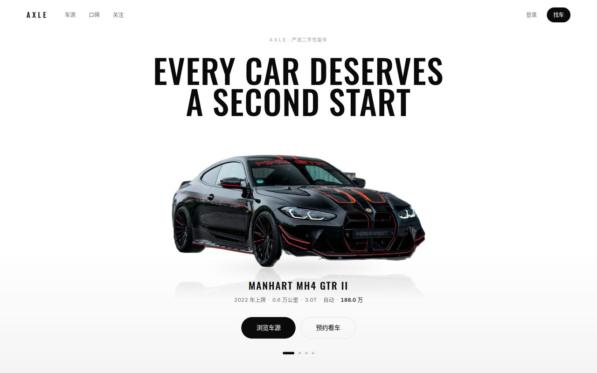
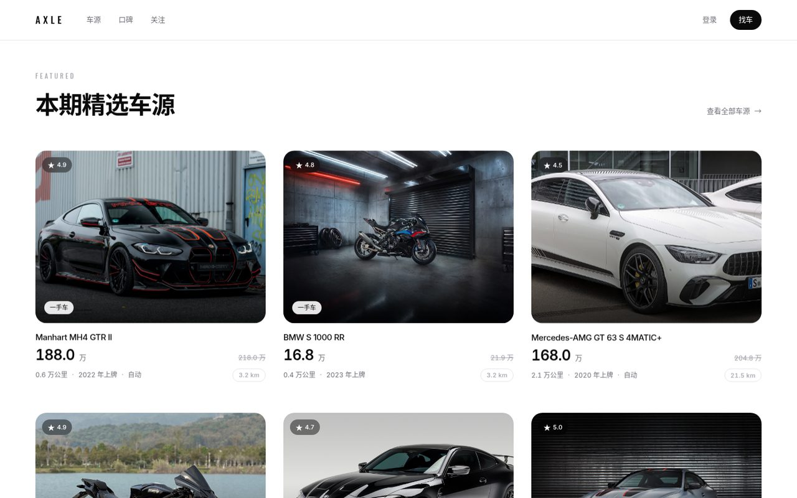

# AXLE · 精选二手车平台前端

用 Vue 3 + TypeScript 写的前端，把[黑马程序员 Redis 教程](https://www.bilibili.com/video/BV1cr4y1671t)那套
**hmdp（黑马点评）后端**重新包装成一个「严选二手性能车」交易平台。





## 这个项目要解决什么

hmdp 后端是跟着教程写的 Redis 实战练习，功能其实相当完整 —— 手机号验证码登录、token 滑动续期、
商铺缓存与逻辑过期、优惠券秒杀一人一单、Redis 分布式锁、点赞、关注 Feed 流、GEO 附近商铺。
但教程自带的前端是 jQuery + 模板页面，只够证明接口通了。

这个仓库把同一批接口接到一个**真看得过去的界面**上：车辆列表对应商铺，秒杀对应限时特价，
点赞和关注对应口碑社区。后端代码一行没改，接口路径与响应结构完全不变。

**后端不在本仓库里。** 见下方「连真实后端」。

## 技术栈

| 层 | 选型 | 说明 |
|---|---|---|
| 框架 | Vue 3.5 `<script setup>` | |
| 构建 | Vite | |
| 语言 | TypeScript | `vue-tsc` 严格校验 |
| 样式 | Tailwind CSS v4 | 走 `@theme`，设计 token 集中在 `src/styles/tokens.css` |
| 状态 | Pinia | |
| 路由 | Vue Router | |
| 动效 | GSAP 3（含 ScrollTrigger）+ Lenis | 两者共享同一个 rAF 时钟，避免滚动与动画打架 |
| 请求 | axios | 拦截器统一注入 token、统一处理 401 |
| 测试 | Vitest | |

## 快速开始

需要 Node 20+ 与 pnpm。

```bash
pnpm install
pnpm dev            # http://localhost:5173
```

**默认走内置 mock 数据**，不需要后端就能看到完整首屏与车源列表。

### 连真实后端

前端请求 `/api/*`，由 Vite 代理到 `http://127.0.0.1:8081`（配置见 `vite.config.ts`）。
后端需要是 `hmdp-master` 的 `usedcar` 分支 —— 它给商铺表加了车辆扩展字段，
接口路径与响应结构仍与原始 hmdp 一致。

```bash
echo 'VITE_USE_MOCK=false' > .env.local
pnpm dev
```

### 命令

```bash
pnpm dev          # 开发服务器
pnpm typecheck    # vue-tsc 类型检查
pnpm build        # 类型检查 + 生产构建
pnpm preview      # 预览构建产物
pnpm test         # Vitest
```

### 车辆抠图（可选）

首屏的车是透明背景 WebP，由 `scripts/cutout-cars.py` 从 `public/cars/*.jpg` 生成：

```bash
python3 -m venv .cutout-venv
.cutout-venv/bin/pip install onnxruntime numpy pillow scipy
.cutout-venv/bin/python scripts/cutout-cars.py            # 默认 u2netp
.cutout-venv/bin/python scripts/cutout-cars.py --model isnet-general-use   # 边缘更锐，需下 176MB
```

模型首次运行自动下载到 `~/.cache/hmdp-cutout/`。仓库里已经带了生成好的产物，
不改素材的话不需要跑这条流水线。

## 设计约定

五条硬约束，写在 `CLAUDE.md` 里，改样式前先读：

1. **全站亮色。** 统一 `#FFFFFF` 底，没有暗色区域，`tokens.css` 里也不再有暗色主题类。
   唯一例外是压在车辆照片上的覆盖层。
2. **界面零彩色。** UI 只用中性灰阶，靠明度反转做强调（主按钮 = 纯黑底白字）。
   整站唯一的色彩来源是车辆照片本身，所以车漆才会跳出来。
3. **字体分工。** `--font-display`（Oswald）只给全大写的拉丁展示文字 —— 字标、首屏主标题、
   车名、栏目标签。中文正文走 `--font-sans`（Inter + Noto Sans SC）。Oswald 没有 CJK 字形，
   中英混排的标题不能用它，否则一行里会掉回两种字体。

首屏还有一条结构性约定：**车台盒子的尺寸写死**（`.hero-stage`），车图在盒内贴合下沿。
这样切换车辆时页面高度不变、轮胎着地线恒定 —— 倒影和接地阴影才有稳定基准。
盒内按**面积**归一（`h = sqrt(A / r)`，见 `src/lib/fit.ts`）：所有车占据相同面积，
长宽比只决定它是宽而扁还是高而瘦。按高度归一的话，宽体车与高瘦车的面积差到 1.48 倍，
高瘦的那台看起来就是小一号。

**开场黑幕**只在「首页 + 本次会话首次访问 + 未要求减弱动效」时放一次 ——
深链与站内导航都不放，开场是进入体验的门，不是每次导航的收费站。
放不放的判断只写在 `index.html` 的 `<head>` 内联脚本里（必须早于 bundle 才能防住首帧白闪），
`src/lib/intro.ts` 只读它留下的 class。站内换页走 `App.vue` 的 `<Transition mode="out-in">`，
所以 `SiteLayout` 在 `App.vue`，**view 里不要再包一层**。

## 目录结构

```
src/
├── api/          接口层，按后端模块分文件（client / car / mock / types）
├── components/
│   ├── business/ 业务组件（IntroCurtain / HeroSection / BrandNav / CarCard / FeaturedCars / ReviewFeed）
│   └── ui/       无业务语义的基础组件（AppButton / AppTag / StatCount / SkeletonBlock）
├── composables/  useReveal（滚动入场）/ useCountUp（数字滚动）/ useScrollTo
├── layouts/      SiteLayout（全站统一布局，由 App.vue 包住 RouterView）
├── lib/          gsap / lenis / intro 单例；fit.ts（车台面积归一公式）
├── router/
├── styles/       tokens.css（设计 token）+ main.css（含路由转场）
└── views/
docs/
├── specs/        设计文档
└── plans/        实施计划
```

## 进度

M1（首页）已完成：首屏轮播、大类切换（全部 / 汽车 / 摩托）、品牌导航、精选车源、热门口碑、页脚。
其余路由先落到 `PlaceholderView`，URL 结构与 `meta.milestone` 已定死，后续按里程碑填实现：

| 里程碑 | 页面 |
|---|---|
| M2 | 车辆详情、限时特价（秒杀） |
| M3 | 车源列表、登录 |
| M4 | 口碑广场、口碑详情、关注动态 |
| M5 | 个人中心 |

## 素材与许可

- **车辆照片是演示用占位素材**，来自公开图库与网络，**未取得明确商用授权**，
  其中部分照片含厂商标识与车牌。它们仅用于演示界面效果。
  本仓库的代码与这些图片的授权是两件事 —— 要在任何正式场景使用，请先替换 `public/cars/` 下的图片。
- 自己换素材的方法（去哪找图、放哪、分辨率要求、选图标准）见
  [`docs/specs/2026-10-15-二手车平台-design.md`](docs/specs/2026-10-15-二手车平台-design.md) §3.6，
  首屏选车口径（朝向 / 配色 / 为什么不能靠缩略图判断）见 §3.7。
  一句话版本：找一张干净的实景侧身照（Unsplash / Pexels，免费商用），
  长边 ≥ 2500px，整车完整入画且四周留白，让抠图流水线处理背景。
  入库前用 `scripts/cutout-cars.py --check` 筛一遍 —— 但它只是筛子，
  产物要放大到 600px 以上人眼过一遍，玻璃幕墙这类与车身连成一片的背景它查不出来。
- 字体 Inter 与 Oswald 通过 Google Fonts 加载，授权为 SIL Open Font License 1.1。
- 仓库暂未附 LICENSE 文件。
